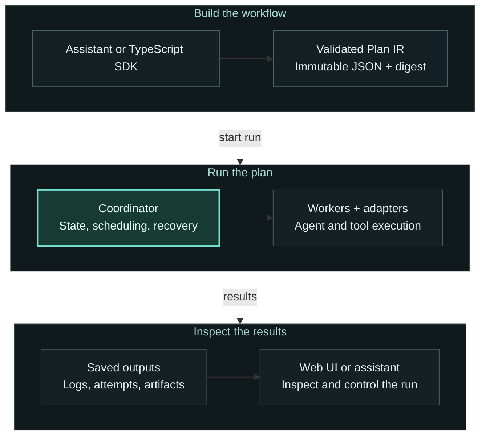

# CLI, SDK, and configuration reference

Muxlio lets you build multi-step workflows across AI agents — Antigravity, Claude, Codex, Cursor, Kiro — and command tools, then run them durably on a coordinator that survives client disconnects. Submit a plan tonight and check the results in the morning.

Workflows are defined in TypeScript, compiled to a canonical **Plan IR** JSON document, and interpreted by a Go coordinator. No JavaScript reaches the runtime: the IR is the contract between authoring and execution. Plans are immutable and content-addressed (SHA-256 digest), so a run always executes the exact bytes that were submitted.

## How it works



The plan defines the work. The coordinator saves state and assigns steps to
workers; adapters run the selected agents and tools. You inspect the same run
through the UI or your assistant.


## Key features

- **Compiled, content-addressed plans** — Workflows compile to a stable Plan IR (v1.0) with a SHA-256 digest. A run pins immutable plan JSON; recovery verifies those bytes, never a latest definition.
- **Fan-out and control flow** — `map` for bounded-concurrency fan-out, `branch` for conditionals, `loop` with finite iteration bounds, `wait` for external signals, `join` for aggregation, `child` for nested sub-runs.
- **Durable execution** — SQLite-backed state, event-sourced history, and explicit recovery. Queued work is eligible for reassignment; effects that may have already happened are held for manual reconciliation rather than silently replayed.
- **Retry and fallback** — Per-step retry policies (`maxAttempts`, bounded backoff) and fallback executors. Effect policies control whether repeating an operation is safe.
- **Agent adapters** — Ship adapters for `agent/a2a`, `agent/acp`, `agent/antigravity`, `agent/claude`, `agent/codex`, `agent/cursor`, `agent/kiro`, and `command`. Custom adapter scripts plug in with no coordinator changes.
- **Observability UI** — A web dashboard for run search, activation/scope graphs, event timelines, logs, artifacts, attempt history, worker status, a **Live** view that streams attempt logs, and a signal form for waiting runs.
- **MCP server** — Exposes coordinator operations as MCP tools so any MCP-capable assistant (Codex, Cursor, Claude Code, Kiro) can build, check, submit, and inspect runs from its own chat.
- **Fake executor for testing** — Validate plans and dataflow end to end without invoking real model calls. Fake outputs are keyed by node ID or executor name.
- **Remote access over SSH** — The coordinator binds to loopback; forward over SSH for secure remote use without exposing an unauthenticated HTTP API.

## Quick start

### Prerequisites

- **Go** 1.26+ (to build the coordinator, CLI, and adapters)
- **Node.js** 18+ (for the TypeScript SDK, compiler, testing harness, and UI)
- **Agent provider CLIs** on `PATH` for whichever executors you intend to use (e.g. `agy`, `claude`, `codex`, `kiro`)

### Build from source

```sh
npm run setup          # builds release prefix under ~/.muxlio and muxlio init
npm run release        # build CLI, adapters, and UI into ~/.muxlio (no init)
```

`npm run setup` runs `scripts/setup.sh`: `scripts/build-release.sh` (Go CLI, eight adapters, UI assets), copies the CLI to `.bin/muxlio` for this checkout, and runs `muxlio init` to create `~/.muxlio/config.json` with a coordinator bearer token. Fresh setup uses this checkout as the workspace; repeated setup preserves the configured workspace. Set `MUXLIO_WORKSPACE=/absolute/path/to/project` during setup or use `muxlio init --workspace /absolute/path/to/project` afterward to select another workspace. Authoring workflows from this checkout still requires `npm run build` once to compile the TypeScript workspaces (`muxlio-sdk`, `muxlio-compiler`, `muxlio-testing`). Override the runtime root with `MUXLIO_HOME`.

`npm run release` runs the same `scripts/build-release.sh` install into `~/.muxlio` (or `MUXLIO_HOME`) without `muxlio init`, SDK workspace builds, or copying the CLI into this checkout’s `.bin/muxlio`. Use it to refresh binaries and UI assets in an existing runtime.

For a custom install prefix without the npm wrapper:

```sh
bash scripts/build-release.sh "$HOME/.local/muxlio"
export PATH="$HOME/.local/muxlio/bin:$PATH"
muxlio init --data-dir "$HOME/.local/muxlio" --workspace /absolute/path/to/project
```

### Initialize runtime

Before `muxlio service start`, point the service at an authorized workspace and the executor capabilities the local worker should advertise:

```sh
# Example: choose a project workspace and install Antigravity authoring instructions
muxlio init --data-dir ~/.muxlio --workspace /absolute/path/to/project --agent antigravity
# Creates ~/.muxlio/{data,logs,work,artifacts,bin,skills,libexec/muxlio/adapters,share/muxlio/ui}
# and ~/.muxlio/config.json (workspace, capabilities, addr, attemptTimeoutSeconds)
# A coordinator bearer token is generated and stored in config.json.
# --starter writes a sample workflow; --client (or --agent) installs the complete skill bundle for that client.
```

For workflows that run checks or local Git commands, use `muxlio init --agent kiro --allow-command`
from the target project. The flag explicitly authorizes command checks and local
Git commits while preserving other executor settings. `muxlio service start` also
starts the configured MCP listener; no Muxlio source checkout or separate MCP
process is needed to build and start workflows through your assistant.

Default capabilities match the shipped adapters: `agent/a2a`, `agent/acp`, `agent/antigravity`, `agent/claude`, `agent/codex`, `agent/cursor`, `agent/kiro`, and `command`. Edit `capabilities` in config to restrict what the service will run.

### Homebrew installation

```sh
brew tap Muxlio/muxlio https://github.com/Muxlio/muxlio
brew install --HEAD Muxlio/muxlio/muxlio
```

The HEAD formula builds the main branch using `scripts/build-release.sh` and
installs the same runtime assets as a source release. To prepare a stable tagged
formula release, maintainers run `scripts/release-formula.sh <version>`, review
the generated archive checksum and formula, then publish the formula update.

### Author a workflow

Workflows are authored with the TypeScript SDK and compile to Plan IR at build time. The high-level API — `workflow`, `task`, `artifact`, `step`, `each`, `repeatUntil` — uses symbolic typed references and Zod schemas; the lower-level `defineWorkflow` builder remains available for advanced cases.

```ts
import { workflow, task, artifact } from '@muxlio/sdk';
import { z } from 'zod';

const input = z.object({
  items: z.array(z.object({ id: z.string(), title: z.string() })).min(1).max(100),
});

const gather = task({
  executor: 'agent/antigravity',
  task: 'Investigate the topic and write findings to findings.md.',
  outputs: { findings: artifact.markdown('findings.md') },
});

const transform = task({
  executor: 'agent/claude',
  task: 'Read the findings and produce result.md.',
  outputs: { result: artifact.markdown('result.md') },
});

export default workflow('batch', {
  input,

  build: ({ input, step, each }) => {
    const results = each(input.items, {
      key: i => i.id,
      concurrency: 5,
    }, item => {
      const gathered = step('gather', gather, { item });
      const transformed = step('transform', transform, {
        findings: gathered.findings,
      });
      return { id: item.id, result: transformed.result };
    });

    return { results };
  },
});
```

The `build` callback runs once at compile time. `step`, `each`, and `repeatUntil` return symbolic proxies — `gathered.findings`, `item.id`, and `transformed.result` are typed references compiled into the plan, not runtime values. Two compilations of the same workflow yield identical content-addressed (SHA-256) digests. `repeatUntil` compiles to a durable loop: run an attempt, evaluate `until` against its outputs, run `otherwise` (a fix) on failure, and `onExhausted: 'pause'` makes the run resumable. See `recipes/implement-features/workflow.ts` for a full prepare → implement → review → verify/fix loop → commit recipe.

Compile it (TypeScript → Plan IR):

```sh
muxlio build examples/batch.workflow.ts --out examples/batch.plan.json
# or validate/compile in one step:
muxlio check examples/batch.workflow.ts
```

`muxlio build`, `check`, `test`, and `run` use the same workflow loading path for `.ts`, `.js`, and `.mjs` files. Source loading requires the operator to set `MUXLIO_TRUST_WORKFLOW_CODE=1`. The CLI executes the module with explicitly installed, project-local tsx 4.23.15 from the workflow file's directory; it never invokes npx or downloads dependencies. All workflow code and its side effects run during compilation with host filesystem and network access. Use JSON Plan IR for untrusted or agent-generated submissions; see [compilation security](execution-security.md#workflow-compilation). The module must default-export an object with a `plan` property or a plan-shaped object. Pass an existing `.json` file to skip workflow execution. `muxlio build` validates and prints canonical Plan IR on stdout by default; use `--out` to write it and `--json` for a structured summary. For reviewed source, install the pinned dependencies with `npm ci` in a trusted environment before compiling.

### Validate and fake-run

```sh
muxlio check examples/batch.plan.json
muxlio test examples/batch.plan.json --input examples/batch.input.json --json
# equivalent one-shot local run:
muxlio run examples/batch.plan.json examples/batch.input.json --json
```

With no `--adapters`, `run` uses the fake executor, which generates placeholder artifact references for declared output ports. This exercises the full execution engine and dataflow without invoking agents. Supply `--fake-config` to control fake outputs by node ID or executor name.

### A small local authoring loop

`examples/acp.workflow.ts` and `examples/a2a.workflow.ts` are minimal ACP and A2A
workflows with fake-config dry runs; see [Which adapter should I use?](../adapters.md).

`examples/local.workflow.ts` mixes an inline command task with an inline agent
summary task. From a built checkout, check the bindings, fake-run the same plan,
and inspect its persisted result:

```sh
muxlio check examples/local.workflow.ts --json
muxlio build examples/local.workflow.ts --out /tmp/local.plan.json --json
muxlio test /tmp/local.plan.json --input examples/local.input.json --fake-config examples/local.fake.json --json
muxlio run /tmp/local.plan.json examples/local.input.json --fake-config examples/local.fake.json --json
muxlio inspect RUN_ID --json
muxlio graph RUN_ID --json
muxlio artifacts RUN_ID --json
```

Replace `RUN_ID` with the `runId` from `run`. Fake execution needs no provider
credentials; `local.fake.json` supplies the command's typed process outputs.
Check/build validate binding shapes, node references (including
nested expressions), declared execute output ports, and dependency cycles before
execution starts. Warnings remain advisory for local and remote runs.

For real execution with a coordinator and one local worker, initialize your
workspace as above, authorize the command executor, and start `muxlio service
start`. Then use `muxlio run examples/local.workflow.ts examples/local.input.json
--server http://127.0.0.1:7600 --json`. This compiles locally and uses the same
worker assignment contract as distributed execution. Inspect the run in the UI
for its graph, queue reason, attempts, and artifacts. `muxlio cancel RUN_ID
--server http://127.0.0.1:7600` cancels it; `muxlio resume RUN_ID --server
http://127.0.0.1:7600` continues a paused run.

### Run with real adapters

For a capability comparison, decision guide, and minimal ACP/A2A examples, see
[Which adapter should I use?](../adapters.md). The subsections below are the
authoritative reference for configuration and limitations.

After `npm run setup` or `build-release.sh`, adapters live under `~/.muxlio/libexec/muxlio/adapters` (see `muxlio env`). Point `run` at that directory with an absolute workspace:

```sh
muxlio run examples/batch.plan.json examples/batch.input.json \
  --adapters "$HOME/.muxlio/libexec/muxlio/adapters" \
  --workspace /absolute/path/to/project \
  --data-dir "$HOME/.muxlio" \
  --json
```

Queued attempts and their activations remain `queued` until a worker claims the
assignment; a running workflow can therefore be waiting for admission without
an agent process executing. Tasks with `fallbackExecutors` default to a 60-second
admission timeout when `queueTimeoutSeconds` is omitted. Set an explicit positive
`queueTimeoutSeconds` to override this window. An admission timeout proves the
attempt never reached a worker and can advance to retry/fallback within the task's
retry and effect policy. An execution timeout does not prove termination and
continues to require the existing cancellation/reconciliation handling.

Each executor maps to one executable file: replace `/` with `-` (e.g. `agent/claude` → `agent-claude`, `command` → `command`). The generic `command` executor passes `program` and `args` directly to the process without a shell. `task({ executor: 'command', ... })` automatically provides typed process outputs, so success is available as `result.passed`, including in `repeatUntil` conditions; no `outputs` declaration is needed. With `onNonZero: 'return'`, a nonzero exit produces `passed: false` so the workflow can run its fix step; `onNonZero: 'fail'` fails the step instead. Command details are also top-level outputs: `exitCode`, `signal`, `stdout`, `stderr`, and `durationMs`. Declare `outputs` only to add artifacts or customize a schema. `signal` is null unless the process was terminated by a signal, and stdout/stderr contain bounded previews. Declared files are collected from `MUXLIO_OUTPUT_DIR`.

`agent/a2a` executes a remote agent using `params: { url: 'https://agent.example', stream: true, timeout: '30s' }`. It discovers `/.well-known/agent-card.json`; `cardUrl` can select another card on the same origin. This adapter supports [A2A 0.3.0 JSON-RPC](https://a2a-protocol.org/v0.3.0/specification/), including an advertised alternate JSON-RPC interface. Other versions, required extensions, unsupported input modes, and unsupported authentication fail explicitly. Only HTTP bearer authentication is supported; supply `A2A_TOKEN` through the shared request secret mechanism, never in workflow parameters or URLs. HTTPS is required except on loopback; redirects and cross-origin card endpoints are rejected. Discovery and authentication are checked at invocation, not by the readiness probe.

Submissions use nonblocking `message/send`. The adapter publishes and returns the remote task ID, context ID and endpoint, allowing the worker process to exit while the task continues. Later polls use that reference without resubmitting. `stream: true` requires advertised streaming and uses `tasks/resubscribe` during polls, followed by a full `tasks/get` snapshot after disconnect or a bounded stream interval. The per-invocation timeout defaults to 30 seconds and cannot exceed one minute. Task and context identities must match on recovery. Configure `effect: 'reconcile'` and require `remoteTask: '1'` for durable remote execution. Known submissions reconcile through read-only task lookup; submissions without a task ID remain inconclusive, including when a task is not found. A2A message IDs do not promise deduplication, so this adapter does not advertise idempotency keys.

Remote agents receive the task, inline inputs, and requested output port names/MIME types. They must return artifacts named after output ports. Scalar ports accept JSON data or JSON text; file ports import text or inline base64 bytes into worker scratch for the generic artifact uploader. URI downloads are unsupported, and responses/artifacts are bounded to 4 MiB. Token usage remains unavailable. Input/auth-required states produce explicit unsupported follow-up errors and remain inconclusive during reconciliation, since the remote task can still resume. Local sessions, push notifications, native typed generation, and remote cancellation are unsupported. Stopping a local invocation does not cancel remote work.

`agent/acp` runs an ACP v1 agent over stdio using `params: { program: '/absolute/path/to/agent', args: ['--acp'], timeout: '10m' }`. Arguments are passed directly without a shell. The default executable is `acp-agent`; set `MUXLIO_ACP_PROGRAM` in the executor's configured environment to select another default (also used by the readiness probe). Explicitly authorize host execution with `executors: { "agent/acp": { allow: true } }`. Configure credentials through that executor's environment and authenticate the agent before running workflows. The probe verifies executable availability; ACP has no standard version or authentication-status command, so protocol and authentication errors are checked at invocation. Runner pins additionally require the configured executable to support `--version`.

The adapter negotiates protocol version 1 and agent capabilities before `session/new`, sends a text prompt with Muxlio result-port paths, and validates the files through the shared output collector. Agent text, tool activity, plans and other session updates appear in live logs. Interrupts send `session/cancel`, with bounded cleanup if the agent does not respond. Permission requests are denied with an explicit unsupported error. Client filesystem/terminal services, durable sessions, session loading, remote tasks and native typed generation are unsupported, even if an agent advertises session loading. ACP session IDs and progress never become durable Muxlio checkpoints. Token usage remains unavailable; context-window and cost updates are not token totals. Keep using a native adapter when its provider-specific capabilities are needed. See the [ACP v1 initialization specification](https://agentclientprotocol.com/protocol/v1/initialization).

Executor permissions and environment values are configured per executor in `~/.muxlio/config.json`. An adapter can declare `requiresHostExecution` in a descriptor beside its executable (`<executable>.json`). Workers apply that shared metadata when advertising and dispatching capabilities. Host execution requires explicit local authorization; workflow parameters cannot grant it. The bundled command adapter also checks the authorization in its runtime request, so missing metadata never enables it. Its `execution.isolation: "sandbox"` option fails closed because this release has no verified OCI command backend.

`examples/command.workflow.ts` shows two tasks using the same executor. Task output files live under the per-attempt artifact directory, exposed to child programs through `MUXLIO_OUTPUT_DIR`; executables must be installed and authorized on the selected worker. Host mode is intended for a self-hosted, single-owner worker. Required execution isolation is configured through the shared sandbox contract; see the [execution security guide](execution-security.md).

To authorize command tasks, configure the command executor and restart the service:

```json
{
  "executors": {
    "command": {
      "allow": true
    }
  }
}
```

The `executors` map is optional and defaults to `{}`. Omitted entries use executor defaults; `allow: false` disables an executor, and `allow: true` explicitly authorizes it. Set `timeoutSeconds` on an executor entry to override the global adapter timeout for that capability (1–86400 seconds); an explicit workflow attempt timeout can still be shorter. The same configuration applies to service, standalone, and outbound workers. Environment values are scoped to the named executor and merged with configured shared worker values. Required isolation filters guest environment values through its execution contract. These entries replace the old top-level `commandHostEnabled` and `sshAgentSocket` settings.

The command adapter forwards the worker's scoped environment generically,
keeping its scratch `HOME`, `TMPDIR`, and output directory. Task `params.env`
can override forwarded values, except managed `PATH`, `HOME`, `TMPDIR`, `LANG`,
and `MUXLIO_OUTPUT_DIR`.

### Implement-features recipe

`recipes/implement-features/workflow.ts` is a ready-to-use recipe: in the current git workspace, each feature runs implement → review → a verify/fix loop (`repeatUntil`, `maxAttempts: 10`, `onExhausted: 'pause'`) → commit. Features run serially (`concurrency: 1`); the commit step is gated on a passed verification via `{ requiresPassed }`. The recipe finishes with verified local commits; it does not push or require Git remote authentication.

Start the coordinator and a worker authorized for the target checkout before
submitting this recipe. Shared writes require durable coordinator admission,
which automatically serializes writes to the resolved workspace; direct
`--adapters` execution cannot enforce these reservations.

Review the commits in the worker's workspace and push manually when ready.
Commits stay on that worker until you push them.

```sh
muxlio check recipes/implement-features/workflow.ts
muxlio run recipes/implement-features/workflow.ts recipes/implement-features/input.json \
  --server http://127.0.0.1:7600 --json
```

The recipe splits task definitions into `tasks.ts` and Zod input schemas into `schemas.ts`, imported by `workflow.ts` — the same pattern to follow for your own multi-file workflows.

## Submit tonight, check in the morning

The durable service pattern keeps work running after you disconnect:

```sh
# Requires muxlio init (or ~/.muxlio/config.json with absolute workspace + capabilities)
muxlio service start
# Background daemon: coordinator, outbound local worker (worker-id local), and bundled UI
# Default http://127.0.0.1:7600 — logs in ~/.muxlio/logs/service.log (service.pid / service.lock)

# Submit compiled Plan IR JSON (not .ts); CLI prints the coordinator response and exits
muxlio submit --server http://127.0.0.1:7600 plan.json input.json
# Loopback requests load the bearer token from ~/.muxlio/config.json automatically
# Use muxlio build/check first, or muxlio run plan.ts input.json --server ... to compile locally then block until done

# Check on it later
muxlio status --server http://127.0.0.1:7600
muxlio status --server http://127.0.0.1:7600 run_RETURNED_ID

# Graceful shutdown or reload config/process
muxlio service stop
muxlio service restart
```

`muxlio run plan.ts input.json --server http://127.0.0.1:7600` compiles the workflow locally, submits it remotely, and blocks until a terminal state (like submit + poll). Closing the client or SSH session does not cancel the coordinator's work. Pause takes effect at the next operation boundary; cancel stops local adapter processes when possible.

For remote access, forward over SSH instead of exposing the API (see [muxlio-docs/service.md](service-reference.md#submit-tonight-check-in-the-morning) for details):

```sh
ssh -N -L 17600:127.0.0.1:7600 mac-mini
muxlio submit --server http://127.0.0.1:17600 plan.json input.json
```

## Observability UI

With the supervised service, static UI assets are served from the coordinator address (same port as the API):

```sh
muxlio service start
# Open http://127.0.0.1:7600/  (UI and clients use the API under /v1/)
```

For a coordinator without the bundled UI, start the API and launch the UI helper on a second port:

```sh
muxlio server start --data-dir ~/.muxlio
muxlio ui --server http://127.0.0.1:7600 --port 7601
# Open http://127.0.0.1:7601/
```

To run the UI locally against a remote coordinator, point `--server` at the coordinator's reachable URL:

```sh
muxlio ui --server http://192.168.1.1:7600 --port 7601
# Open http://127.0.0.1:7601/
```

The UI helper binds to `127.0.0.1` by default and proxies API requests to the remote coordinator. It uses `MUXLIO_TOKEN` when set, otherwise the token in the local `~/.muxlio/config.json` (including the default server profile). Make sure that token belongs to the coordinator you selected. From a development checkout, the equivalent is `MUXLIO_API_URL=http://192.168.1.1:7600 npm --prefix muxlio-ui start`.

If a UI is already running on port 7601, stop that process before starting it with a different coordinator URL; the CLI reuses an existing UI process.

The dashboard provides run search and state filters, input/output/error and timing details, the materialized activation/scope graph, logs, execution attempt history, a cursor-paginated event timeline, active worker assignments, a **Live** page for streaming attempt logs from running activations, and a send-signal form for waiting runs.

### OpenTelemetry export

Local runs, coordinators and remote workers can export OTLP/HTTP traces and metrics.
Set these variables on each process (including service child processes):

```sh
export OTEL_TRACES_EXPORTER=otlp
export OTEL_METRICS_EXPORTER=otlp
export OTEL_EXPORTER_OTLP_ENDPOINT=http://localhost:4318
export OTEL_SERVICE_NAME=muxlio
```

Export is disabled by default; each signal accepts `otlp` or `none`.
Standard OTLP endpoint, TLS and header environment settings configure the HTTP
exporters. Command shutdown flushes pending telemetry with a five-second limit.

Run, activation, attempt, worker and adapter invocation spans share W3C trace
context carried in durable assignments. Muxlio IDs remain span attributes.
Activation and attempt IDs use `sha256:` followed by the SHA-256 hex digest of
the original ID, consistently across processes, because their scope paths can
contain input-derived map keys. Run IDs retain their generated values.
The shared adapter request includes a `traceContext` map containing W3C
`traceparent` and, when present, `tracestate`, so adapter-owned instrumentation
can continue the invocation span without receiving baggage.
Resumed coordinator executions start another trace segment; the run and attempt
IDs correlate those segments with previously dispatched work. Generic tool spans
use `gen_ai.operation.name=execute_tool` and `gen_ai.tool.name`; workflow spans
use `invoke_workflow`. Provider and model identity stay adapter-owned. Reported
token counts use `gen_ai.usage.*`; unavailable usage is absent and reported zero
remains zero. These attributes follow the
[OpenTelemetry GenAI conventions](https://github.com/open-telemetry/semantic-conventions-genai/tree/main/docs/gen-ai).

Metrics use seconds for `muxlio.queue.delay` (enqueue to claim),
`muxlio.execution.duration` (executor invocation to return, excluding queue and
completion transport), `muxlio.adapter.duration` (local adapter invocation), and
`muxlio.lease.age` (time since claim or the last acknowledged renewal).
`muxlio.worker.slots.used`, `muxlio.worker.slots.capacity` and
`muxlio.worker.slot_pressure` expose heartbeat snapshots; pressure is occupied
slots divided by capacity. Metric dimensions use executor or worker identity,
without per-run IDs.

Prompt bodies, params, inputs, transcripts, artifact contents, secrets and error
messages are excluded from this instrumentation. It propagates trace identity
without baggage. Content capture is not enabled by any Muxlio setting.

## Workers

- **Local worker (service)** — `muxlio service start` registers an outbound worker (`worker-id` `local`) that executes steps in `config.json` `workspace` using adapters from `adapters` (default `~/.muxlio/libexec/muxlio/adapters`). Only capabilities listed in `config.json` are advertised, even if more adapters exist on disk.
- **Remote worker** — On another machine, connect with explicit identity and optional capacity:

```sh
muxlio worker start \
  --coordinator http://127.0.0.1:7600 \
  --worker-id mac-mini-1 \
  --workspace /path/to/workspace \
  --worker-token-file ~/.muxlio/worker-token \
  --capacity 2
# Use MUXLIO_WORKER_TOKEN or --worker-token / --worker-token-file for remote worker authentication.
```

Omit `--capabilities` to auto-detect executable adapters in `--adapters` (default `~/.muxlio/adapters`). For a release install, pass `--adapters ~/.muxlio/libexec/muxlio/adapters`; alternatively copy or symlink the adapters there. Pass a comma-separated list to advertise a subset. `--capacity` sets concurrent assignments (default 1; override with `MUXLIO_WORKER_CAPACITY`).

Supported first-party executors (one adapter binary each): `agent/a2a`, `agent/acp`, `agent/antigravity`, `agent/claude`, `agent/codex`, `agent/cursor`, `agent/kiro`, and `command`.

Local agent adapters run in the selected attempt workspace, including snapshots
without Git metadata. Each adapter supplies its CLI's headless workspace options
and access to the separate scratch directory for declared outputs. Antigravity and
Claude use the same workspace selection and output prompt as the other local
agents. ACP forwards the selected directory to its configured agent; that agent's
launch options remain in `params.args`. A2A runs remotely and does not use a local
agent workspace.

Antigravity uses the model configured in its CLI unless `params.model` overrides it.
Its readiness check recognizes `ANTIGRAVITY_API_KEY` and saved Antigravity API-key or Google login
credentials; credential validity is checked when the task runs.

## MCP integration

The `muxlio-mcp` binary exposes coordinator operations as MCP tools over stdio or authenticated Streamable HTTP. Any MCP-capable assistant can call them to build, check, run, and inspect workflows without leaving its chat:

```json
{
  "mcpServers": {
    "muxlio": {
      "command": "muxlio-mcp",
      "args": ["--server", "http://127.0.0.1:7600"]
    }
  }
}
```

`muxlio init` registers MCP HTTP at `127.0.0.1:7602` and prepares persistent
authentication tokens. The service starts and stops MCP with the coordinator.
For direct network access, run `muxlio init --mcp-listen 0.0.0.0:7602` and
`muxlio service restart` on the server, then connect the client to
`http://<server>:7602/mcp`. HTTP requests
require the listener's bearer token (the coordinator token by default); optional
TLS is available with `mcp.tlsCert` and `mcp.tlsKey`. No SSH or local MCP process is
required for this connection. See the [network setup](mcp-reference.md#network-transport-streamable-http).

Available tools include `build`, `test`, `check_plan`, `start_run`, `list_runs`, `get_run`, `get_graph`, `get_events`, `get_activations`, `get_attempts`, `get_logs`, `get_snapshots`, `register_workflow_version`, `list_workflow_versions`, `get_input_requests`, `respond_input_request`, `read_artifact`, `get_artifact_metadata`, `cancel_run`, `pause_run`, `resume_run`, `retry_run`, `send_signal`, `get_workers`, and `server_health`. Saved coordinator profiles and bearer authentication are supported; for example, use `muxlio-mcp --server coordinator`. See [muxlio-docs/mcp.md](../mcp.md) for the full reference.

## Testing with fakes

`@muxlio/testing` exports `testWorkflow` and `fakeExecutor` for validating workflows end to end without real model calls:

```ts
import { workflow, task, artifact } from '@muxlio/sdk';
import { z } from 'zod';
import { fakeExecutor, testWorkflow } from '@muxlio/testing';

const summarize = task({
  executor: 'agent/codex',
  task: 'Summarize the input.',
  outputs: { summary: artifact.markdown('summary.md') },
});

const compiled = workflow('example', {
  input: z.object({ text: z.string() }),
  build: ({ input, step }) => {
    const s = step('summarize', summarize, { text: input.text });
    return { summary: s.summary };
  },
});

const result = await testWorkflow(compiled, {
  input: { text: 'Example' },
  executors: fakeExecutor.byNode({
    summarize: { outputs: { summary: { digest: 'sha256:fixture', mime: 'text/markdown' } } },
  }),
});
if (result.state !== 'succeeded') throw new Error(`Run state: ${result.state}`);
```

## Workflow evaluations

`@muxlio/testing` can compare compiled workflow versions over typed datasets.
Cases are normalized before any run starts; expected outputs are optional.
Unchanged datasets returned by `defineDataset` retain their normalized values
when reused, including values produced by transforming parsers. Scorers
run only after successful execution and output validation. A zero score or a
scorer error does not change execution success.

```ts
import { defineDataset, evaluateWorkflow } from '@muxlio/testing';

const dataset = defineDataset({
  id: 'summaries/v1',
  input: z.object({ text: z.string() }),
  output: z.string(),
  cases: [{
    id: 'greeting',
    input: { text: 'Hello world' },
    expected: 'Hello',
  }],
});

const report = await evaluateWorkflow({
  dataset,
  versions: [
    { id: 'baseline', workflow: baseline },
    { id: 'candidate', workflow: candidate },
  ],
  concurrency: 4,
  configuration: { executors: fakeExecutor.byExecutor({
    summarize: { outputs: { summary: 'Hello' } },
  }) },
  scorers: [{
    id: 'exact-match/v1',
    score: ({ output, expected }) => Number(output === expected),
  }],
});
```

The default runner uses the CLI with fake executors. For real experiments,
provide `runner: { id: 'my-runner/v1', async run(workflow, options) { ... } }`
that executes `workflow.plan` with `options.input` and returns the shared
`EvaluationExecution` shape (`state`, `output`, optional `runId`, `error`, and
`accounting`). Configuration is passed to each run. Give runners and scorers new
versioned IDs when their implementations change, and version the dataset ID
when its schema changes. Inputs, plans, expectations, and configuration must
be JSON serializable with finite numbers. Functions, symbols, bigint values,
and undefined array entries are rejected before execution.

The report includes ordered case/version results, execution duration, errors,
accounting, and named scores. Missing accounting is `null`; reported zero remains zero.
Accounting retains exact decimal strings, collected and estimated contributions,
fidelity and coverage without inferring tokens. The manifest contains copied plans, recomputed plan digests, a dataset
digest (including expected outputs), a configuration digest, runner/scorer IDs,
and a content-derived evaluation ID. Plans, cases, and configuration are copied
before execution so caller or runner mutations cannot change subsequent runs.
Returned execution output and accounting are also copied to isolate each result.
These identities pin the experiment specification; external model behavior and
services can still vary. Keep the dataset alongside the manifest for replay.


### Forking and comparing runs

`POST /v1/runs/:sourceId/fork` creates a new run from a terminal run's original
inputs and pinned plan. The JSON body accepts an optional replacement `input`,
`plan` or registered `planDigest`, and `reuseActivations` containing successful
activation IDs from the source. For example:

```json
{"reuseActivations":["run_original:analyse"],"start":false}
```

The new run persists its source run and source plan digest. Creation does not
execute steps; use `POST /v1/runs/:newId/start` or request `"start":true` at
creation. Unstarted forks remain dormant across coordinator restarts.
Forks execute only steps explicitly declared `retry.effect: "pure"`.
Steps with sessions, remote tasks, workspace state, or exclusive resources are
blocked even when labelled pure. Unsafe steps fail with a diagnostic before
any dispatch; external effects, attempts, signals, and session state are never
copied. The original history remains unchanged.

Selected outputs are reused only for steps declaring `workspaceMode: "empty"`
and only when the recorded dependency fingerprint matches. Steps using the
default workspace recompute because its source can change between runs.
Empty mode creates a private workspace without copying the worker checkout;
it does not restrict arbitrary host access by native code. This version fingerprints the full pinned plan, node contract,
resolved dependencies, inputs, and structural scope; any plan change disables
reuse. Legacy outputs without fingerprints are recomputed. File outputs require
content-addressed artifact references. Each reuse appends an
`activation.output_reused` event with the source run, source activation, and
fingerprint. Reuse creates no new execution attempt or copied charges.

`GET /v1/runs/:sourceId/compare?other=:newId` returns both plans, inputs, results,
and activation differences aligned by scope, node, and occurrence, along with
reuse references and both usage summaries. Observed and estimated costs remain
separate, and unavailable costs remain unavailable. Forking and comparisons
across runs require an administrator credential; run-scoped read credentials
cannot reveal another run through comparison.


## Monorepo structure

| Path | Language | Description |
|------|----------|-------------|
| `muxlio-core` | Go | Coordinator, `muxlio` CLI, `muxlio-mcp` server, Plan IR interpreter, SQLite state store |
| `muxlio-adapters` | Go | Executor adapter binaries (agent CLIs and command tools) |
| `muxlio-sdk` | TypeScript | `@muxlio/sdk` — plan builder and types for authoring workflows |
| `muxlio-compiler` | TypeScript | `@muxlio/compiler` — restricted TS frontend that lowers to Plan IR |
| `muxlio-testing` | TypeScript | `@muxlio/testing` — fake workers, fixtures, and test harness |
| `muxlio-ui` | JS/HTML | Observability web UI for the coordinator |
| `muxlio-skills` | Markdown | Workflow authoring guide |
| `muxlio-docs` | Markdown | Architecture, MCP, and service documentation |
| `examples` | TypeScript | Example workflows (batch fan-out, audit-coverage with branch/map) |
| `recipes` | TypeScript | Ready-to-use recipes ([implement-features](https://github.com/Muxlio/muxlio/blob/main/recipes/implement-features/workflow.ts), [package bug sweep](https://github.com/Muxlio/muxlio/blob/main/recipes/fix-package-bugs/README.md)) |
| `scripts` | Shell | Build, setup, start, upgrade, and install verification scripts |

## CLI reference

```text
muxlio init [--data-dir dir] [--workspace dir] [--agent name] [--starter]
                                                    Initialize runtime and optionally install agent skills/sample workflow
muxlio build <workflow.ts|plan.json> [--out file]    Compile workflow to canonical Plan IR
muxlio check <workflow.ts|plan.json>                Validate a workflow or plan
muxlio test <workflow.ts|plan.json> --input in.json  Test run with fake executor
muxlio run <workflow.ts|plan.json> [input.json]     Run a plan (fake or real executor; or --server to submit remotely)
muxlio graph <workflow.ts|plan.json|run-id>         Display DAG visualization (ascii, json, mermaid)
muxlio inspect <workflow.ts|plan.json|run-id>       Print plan structure or run status
muxlio events <run-id> [--since seq] [--limit N]    Print run execution events
muxlio snapshots <run-id> [--current]               Inspect intermediate artifact snapshots
muxlio gc [--apply TOKEN]                         Preview or apply offline retention cleanup
muxlio artifacts <run-id>                           List artifacts generated by run
muxlio signal <run-id> --name <sig> [--data file]   Deliver external signal to waiting run
muxlio runs [--state state]                       List runs in the local runtime (optionally filtered by state)
muxlio ui [--server URL] [--port port] [--open]     Launch or open the Observability UI
muxlio env [--shell bash|zsh|fish]                  Display or export environment configuration
muxlio doctor [--server URL]                        Run installation and environment health checks
muxlio upgrade [--prefix dir]                       Upgrade Muxlio runtime from source repository
muxlio server start|install                         Start or install the coordinator server
muxlio worker start                                 Connect an outbound remote worker (auto-detects capabilities)
muxlio service start [--config path]                Start supervised coordinator, worker and UI (background)
muxlio service stop [--config path]                 Stop the running service
muxlio service restart [--config path]              Stop then start the service (start if not running)
muxlio submit [--server URL] plan.json input.json    Submit a durable run
muxlio status [--server URL] [run-id]                Query remote run status
muxlio pause|resume|cancel [--server URL] run-id      Control a remote run
muxlio version                                      Print version info
```

Global options: `--json`, `--server <profile|URL>`, `--token <token>`, `--token-file <file>`, `--fake-config <file>`, `--adapters <dir>`, `--workspace <dir>`, `--data-dir <dir>`, `--addr <host:port>`.

## Development

```sh
# Build all TypeScript workspaces
npm run build

# Run tests
(cd muxlio-core && go test ./...)
(cd muxlio-adapters && go test ./...)
npm test
npm --prefix muxlio-ui run smoke

# Build a release prefix and verify it
bash scripts/build-release.sh /tmp/muxlio-install
bash scripts/verify-install.sh /tmp/muxlio-install
```

Run `npm run build` before Go tests to include the real async compiler regression. Tests use temporary runtimes, ephemeral loopback ports, and fake adapters — they do not install a service or control an existing coordinator.

## Plan IR node kinds

| Kind | Purpose |
|------|---------|
| `execute` | Run a single step through an executor (agent or command) |
| `map` | Fan out over an array with bounded concurrency and per-item keys |
| `branch` | Conditional execution with `then` / `else` subgraphs |
| `loop` | Iterate with a finite `maxIterations` bound |
| `join` | Aggregate results across fan-out branches |
| `wait` | Wait for a timer, signal, or durable input response |
| `child` | Invoke a nested subgraph with a bounded recursion depth |
| `project` | Reshape or extract values from bindings |

## Security notes

- The UI supplies operator credentials to loopback peers and same-origin private-network peers using a private IP Host; cross-origin and cross-site browser requests fail closed. Other remote requests require an explicit **Bearer token** and retain its scope. Prefer loopback with SSH forwarding. For public web hosting, use TLS and an authenticated gateway that supplies a separate scoped credential for each user; see [remote web and MCP access](execution-security.md#remote-web-and-mcp-access). `muxlio init` creates the administrator token in `~/.muxlio/config.json`. The CLI attaches it for loopback URLs; override with `MUXLIO_TOKEN`, `--token`, or `--token-file`. `/healthz` stays public for liveness checks.
- Any client that can reach the service with a valid token can submit plans that invoke advertised capabilities with your user permissions. Treat MCP and HTTP access as equivalent.
- The service runs as your login user, never as root. A workspace is an execution target, not a filesystem sandbox. Native child processes receive a minimal environment with `HOME` set to the operator's real home by default (reusing existing provider logins such as `~/.codex`, `~/.cursor`); set an explicit `agentHome` to use a dedicated credential directory instead. Required isolation (OCI/bwrap/VM) uses a scratch HOME and mounts no provider credentials. For Cursor on headless macOS, see [muxlio-docs/service.md](service-reference.md#configure-and-start) for the one-time credential store setup.
- Remote workers may continue an operation already assigned to them after a run is cancelled, so external side effects can occur after cancellation. Recovery does not guarantee exactly-once execution for arbitrary external systems.

## Configuration

The coordinator reads `~/.muxlio/config.json` (override with `--config PATH` or `MUXLIO_CONFIG`). Key fields:

| Field | Description |
|-------|-------------|
| `workspace` | Authorized execution workspace (absolute path; required for service start) |
| `capabilities` | Executor capabilities the local worker advertises (defaults created by `muxlio init` list the bundled capabilities; edit to restrict them) |
| `attemptTimeoutSeconds` | Per-attempt timeout (default 600) |
| `workerEnv` | Shared native executor environment; saved by init and overridden by per-executor `env` |
| `mcp` | Service-owned MCP HTTP listener: `listen`, optional `tokenFile`, `tlsCert`, `tlsKey`, `allowOrigins`; `muxlio init` registers loopback port 7602 |
| `runtimeDir` | Runtime data directory (default `~/.muxlio`) |
| `addr` | Listen address (default `127.0.0.1:7600`) |
| `adapters` | Adapter directory (default beside installed CLI: `libexec/muxlio/adapters`) |
| `ui` | Static UI assets (default `share/muxlio/ui`; served at `/` when using `service start`) |
| `agentHome` | Credential directory for native adapters (defaults to the operator's home) |
| `executors` | Per-executor operator policy: `allow`, `env`, `secretEnv`, and `timeoutSeconds` |
| `token` | Bearer token for API access (auto-generated by `muxlio init` if missing) |
| `defaultServer` / `servers` / `profiles` | Named coordinator URLs for `--server` (optional) |

Environment overrides: `MUXLIO_HOME`, `MUXLIO_ADDR`, `MUXLIO_ADAPTERS`, `MUXLIO_UI`, `MUXLIO_WORKSPACE`, `MUXLIO_CAPABILITIES` (comma-separated), `MUXLIO_SERVER`, `MUXLIO_TOKEN`, `MUXLIO_CONFIG`. Explicit environment values take precedence over config.

Runtime layout under `~/.muxlio`: `data/coordinator.db` (SQLite), `logs/` (including `service.log`), scratch `work/`, `artifacts/`, `bin/`, `libexec/muxlio/adapters/`, `share/muxlio/ui/`, `service.pid`, `service.lock`, `config.json`, `env` (shell exports).

## License

Apache License 2.0. See [LICENSE](https://github.com/Muxlio/muxlio/blob/main/LICENSE) for details.
## Durable input requests

A `wait` node with `waitFor: "input"` asks an authenticated human or agent for
information. Approvals use the same contract as other input. The coordinator
persists the request and enters `waiting` without dispatching a worker or holding
a worker slot. Restarting the coordinator resumes the same request.

```json
{
  "id": "review",
  "kind": "wait",
  "waitFor": "input",
  "signalName": "release-review",
  "requestSchema": {
    "type": "object",
    "required": ["approved"],
    "properties": {"approved": {"type": "boolean"}},
    "additionalProperties": false
  },
  "requestExpiresSeconds": 3600,
  "requestPermissions": ["release:review"]
}
```

`requestSchema`, expiration and permissions are optional. Schemas must be
self-contained JSON Schema; remote references are disabled. Responses may be any
JSON value matching the schema. Zero or omitted expiration has no deadline.
An expired request fails the wait. A successful wait exposes the accepted value
on its `response` output port. Request IDs derive from activation identity, so
parallel map items with the same name remain individually addressable.

Use `GET /v1/runs/:runId/input-requests` to discover IDs, schemas, deadlines,
permissions and states. Submit a JSON response as the body of
`POST /v1/runs/:runId/input-requests/:requestId`, with an `Idempotency-Key` header.
Scoped credentials need `inputs` on that run plus **every** permission declared
by the request; listing accepts `read` or `inputs`. Operator credentials can
respond to all requests. The authenticated credential identity is recorded with
the accepted response; clients cannot choose the responder identity.

Delivery has at-most-once acceptance per request: the first response wins.
Retrying with the same nonempty key returns the original response and
`accepted: false`, without consuming another response, even after a restart.
A different key after fulfillment, an expired request, or a cancelled request
returns HTTP 409. Malformed JSON returns 400, schema mismatches 422, and missing
permissions 403. Retrying a response still requires authorization and valid JSON
matching the schema. Name-based signals cannot fulfill input requests.

```sh
muxlio signal RUN_ID --list-requests
muxlio signal RUN_ID --request-id REQUEST_ID --idempotency-key DELIVERY_ID --data '{"approved":true}'
```

MCP exposes `get_input_requests` and `respond_input_request` (arguments:
`runId`, `requestId`, `idempotencyKey`, `response`). The run workbench displays
each request with schema-driven controls and a JSON editor for complex schemas.
Existing `waitFor: "signal"` waits retain name-based delivery; CLI
`--idempotency-key` and MCP `send_signal.idempotencyKey` deduplicate retries.

## Outbound lifecycle subscriptions

Subscriptions are optional and deliver persisted lifecycle events independently
of workflow execution. Create an immutable subscription with the administrator
credential using `POST /v1/subscriptions`:

```json
{
  "id": "workflow-notifications",
  "target": "https://receiver.example.com/muxlio",
  "secret": "replace-with-at-least-16-secret-bytes",
  "eventTypes": ["run.succeeded", "run.failed", "run.waiting", "worker.*"],
  "redactFields": ["input", "output"],
  "maxRetries": 5
}
```

For metadata-only run notifications, add `"payloadMode": "notification"` and
select the events you want, for example:

```json
{
  "id": "run-notifications",
  "target": "https://receiver.example.com/muxlio",
  "secret": "replace-with-at-least-16-secret-bytes",
  "payloadMode": "notification",
  "eventTypes": ["run.succeeded", "run.failed", "input.required", "execution.reconciliation_required"],
  "maxRetries": 5
}
```

Notification mode emits only these four event types, plus `run.cancelled` when
selected (including through `*` or `run.*`). Success and cancellation have kind
`completion`; failure has kind `failure`. The two attention events have kinds
`input_required` and `reconciliation_required`. Input events are committed with
each newly pending request, including requests renewed by explicit retry;
recreating the same request emits nothing. Reconciliation events are committed
when an attempt first enters reconciliation or acquires an unresolved reason; repeated
updates during that wait emit nothing. Each distinct wait has its own source
event ID. These events do not depend on a connected MCP client.

The usual signed envelope retains the source event's `eventId`, `eventType`,
`runId`, `seq`, `timestamp`, and `subjectId`. Its payload is exactly:

```json
{
  "version": 1,
  "source": "muxlio.run-event",
  "kind": "completion",
  "links": {
    "run": "/runs/<escaped-run-id>",
    "status": "/v1/runs/<escaped-run-id>/summary"
  }
}
```

Links are relative to the coordinator, use normal authentication, and contain
no bearer tokens. The run link opens the web UI; the status link returns the
same summary exposed by MCP `get_run_summary`. Notification payloads exclude
workflow names, prompts, transcripts, input schemas/answers, outputs, failure
text, and external operation references **before persistence**, without relying
on configured redaction. Additional `redactFields` still apply. Omitting
`payloadMode` (or choosing `event`) preserves the lifecycle event payload behavior
below. Unknown modes are rejected.

Notifications describe durable past transitions, not a fresh assertion that all
work or external effects have finished. Follow the status link for the current
canonical outcome, unresolved input/reconciliation, and further inspection links.
A receiver may display that link, send an alert, or use a host-supported client
integration. Muxlio cannot generally resume a disconnected client conversation
or reopen a closed chat. Delivery is optional; later MCP status retrieval works
without a subscription or a live original client.

Filters accept exact event names, category prefixes such as `run.*`, or `*`.
`worker.activity` reports worker assignment lifecycle activity; execution attempt
outcomes can also be selected with `execution.attempt`. New subscriptions replay
matching retained events, then follow new events. Disabled subscriptions do not
fan out or deliver. Definitions default to enabled; secrets are write-only.

Each POST contains `eventId`, `eventType`, `runId`, `seq`, `timestamp`,
`subscriptionId`, `subjectId`, and `payload`. Deduplicate by `eventId`: delivery
is at least once, and IDs remain stable across retries and coordinator restarts.
Verify `X-Muxlio-Signature` as `sha256=` plus the hex HMAC-SHA256 of the exact raw
body using the subscription secret. Verification must use a constant-time
comparison. `X-Muxlio-Event-ID` also carries the event ID. Optional
`signatureHeader`, `signaturePrefix`, and `signatureEncoding` (`hex` or `base64`)
customize signing. Signature headers cannot use transport headers or
`Content-Type` / `X-Muxlio-Event-ID`; prefixes must use printable ASCII and
cannot start with whitespace.
Redirects are rejected.

Credential fields and embedded credentials are scrubbed automatically.
`redactFields` removes additional field names recursively, including within
arrays, before delivery records are persisted and bodies are signed. Choose
these fields to exclude sensitive workflow data specific to your application.
The envelope is capped at 1 MiB. Delivery records expose generic failure reasons,
never receiver response bodies or errors containing payloads or credentials.

Delivery runs in the background with a five-second request timeout and bounded
exponential backoff (one to 256 seconds after an attempt finishes).
`maxRetries` defaults to five, accepts
zero to fifty, and counts retries after the first attempt. An outage never
changes the workflow outcome. Pending deliveries and retry counts survive
restarts. Coordinator shutdown leaves interrupted deliveries pending without
consuming retries. Embedded coordinators may register in-process hooks on
`subscription.Dispatcher.Hooks` and target them with `local:hook-name`; hooks
receive the same signed, redacted bytes. API definitions cannot execute shell
commands. Hook invocations are bounded to one outstanding call per dispatcher;
a hook that ignores cancellation cannot block coordinator shutdown.

Administrator-only inspection and controls:

- `GET /v1/subscriptions` and `GET /v1/subscriptions/:id`: definitions without secrets.
- `GET /v1/subscriptions/:id/deliveries`: up to 1,000 recent delivery records.
- `GET /v1/subscriptions/deadletters`: up to 1,000 exhausted deliveries.
- `POST /v1/subscriptions/deliveries/:deliveryId/requeue`: start a new bounded
  retry cycle for a dead letter, preserving its event ID.
- `DELETE /v1/subscriptions/:id`: permanently disable fanout and delivery while
  retaining history. IDs cannot be reused; create a new ID to change a receiver
  or signing key.

## Inbound webhook triggers

Register a validated plan with `POST /v1/workflow-versions`, then create an
immutable trigger with `POST /v1/triggers` using the administrator credential:

```json
{
  "id": "incoming-task",
  "workflowDigest": "sha256:<registered-plan-digest>",
  "secret": "<at-least-16-bytes-of-random-secret>",
  "inputMapping": {"title": "{{/event/title}}", "count": "{{/event/count}}"},
  "payloadLimitBytes": 1048576,
  "deduplicationSeconds": 86400
}
```

Send raw JSON with `POST /webhooks/incoming-task`. This route requires the
trigger's HMAC-SHA256 signature on every request, including local requests;
a coordinator bearer token cannot replace it. The default signature is the
hex-encoded HMAC of the exact request body in `X-Muxlio-Signature`. Configure
`signatureHeader`, `signaturePrefix` (for example `sha256=`), and
`signatureEncoding` (`hex` or `base64`) for another generic signing convention.
Provider-specific event translation belongs in the sender or an adapter.
Secrets are write-only in the API and stored in the coordinator database;
protect the database and use HTTPS for remote delivery.

`Idempotency-Key` (up to 256 bytes) scopes retries to a trigger. Within the
configured window, concurrent or repeated valid deliveries return the same run
(`200`, `duplicate: true`); the first delivery returns `201`. The window starts
at the first accepted delivery and survives coordinator restarts. After expiry,
the key can create a new run. Without a key each accepted delivery creates a run.
HMAC covers the body; senders must keep the idempotency header stable on retries.

Mapping strings use RFC 6901 JSON pointers in `{{/path}}`. A whole reference
preserves the source JSON type; embedded references interpolate scalar values.
With no mapping, the payload itself is the input. Invalid signatures, oversized
or malformed JSON, missing references, and inputs that fail the pinned plan's
input schema never create runs. The default payload limit is 1 MiB (maximum
8 MiB). Mapped input is also capped at 8 MiB, including repeated references
and JSON escaping. The default deduplication window is 24 hours (maximum 30 days).
Triggers default to enabled; `enabled: false` creates an inactive trigger.
Definitions are immutable: use a new trigger ID to change a pin or secret.

Inspect definitions with `GET /v1/triggers` or `GET /v1/triggers/:id` and audit
delivered, duplicate, and rejected attempts with
`GET /v1/triggers/:id/deliveries`, all under administrator authentication.
Each delivery records its workflow digest; each run stores the same digest and
immutable plan bytes, independent of subsequently registered versions.

The test-event command sends a real signed delivery and creates a real run:

```sh
muxlio test-event --server https://coordinator.example \
  --secret-file /secure/trigger-secret --idempotency-key test-001 \
  incoming-task event.json
```

Use `--signature-header`, `--signature-prefix`, and `--signature-encoding` when
the trigger uses custom signing settings. Repeating the command with the same
key exercises deduplication.

### Large-run operations in the UI

The execution workbench pages executions, event history, attempt history,
outputs and intermediate snapshots independently. Refresh preserves the selected
history page; live events use a separate bounded feed. Artifact bytes, full
attempt results, and run input/output values load when opened.

The **Operations & usage** tab shows the pinned version, run limits, detached
operations, reconciliation holds, and collected/estimated/unavailable accounting.
Worker details expose readiness checks, capability contracts and placement
labels. Persistent sessions expose supported input-delivery policies and receipts.
Token counts automatically use K, M, or B units.

Paged reads are opt-in for API clients: `/v1/runs?offset=0&limit=25`,
`/v1/runs/:id/graph?offset=0&limit=50`, and
`/v1/runs/:id/attempts?offset=0&limit=50&details=false` return `hasMore`
and `nextOffset`. `/v1/runs/:id?summary=true` omits input/output bodies while
preserving totals across the whole run. `/v1/runs/:id/outputs` lists port
metadata; `/v1/outputs` lists file references across runs without inline bytes.
